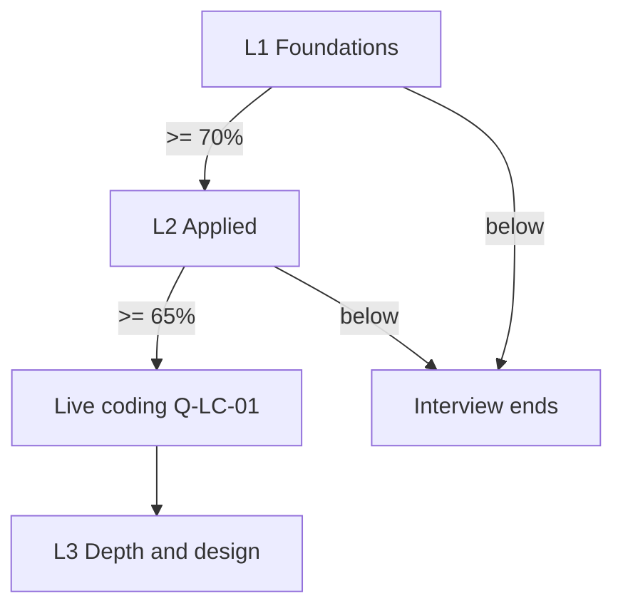

# Interview Kit: PostgreSQL Query Performance & Indexing

- **Kit ID:** postgres-indexing
- **Built:** 2026-08-30
- **Source file:** example/source-postgres-indexing.md
- **Role target:** Mid-level Backend Engineer (inferred from source — "new backend engineers", 200ms p99 budget, no schema-design ownership implied)
- **Total questions:** 6, including one live-coding task (abbreviated demonstration kit; a real kit is 15–20)
- **Question files:** questions.md
- **Contract version:** 1

## Levels

| Level | Name | Questions | Pass threshold | Gate |
|-------|------|-----------|----------------|------|
| L1 | Foundations | 2 | 70% | Must pass to reach L2 |
| L2 | Applied | 2 + Q-LC-01 | 65% | Must pass to reach L3 |
| L3 | Depth & Design | 1 | 60% | Terminal |

Levels run in order and the interview stops at the first gate that is not
cleared:

## Live coding

- **Segment:** yes
- **Placement:** after L2's questions, scored into L2
- **Questions:** Q-LC-01
- **Total budget:** 20 min
- **Mode:** review-only
- **Runtime:** PostgreSQL 16 — no live database is provisioned for this
  demonstration kit, so the query is scored by reading it.
- **Environment prerequisites:** none. A `runnable` version of this kit would
  require a seeded PostgreSQL 16 instance and would ship
  `livecode/Q-LC-01/tests.sql`; `livecode-contract.md` describes that path,
  which this abbreviated kit does not demonstrate.
- **Workspace:** `livecode/`

## Scope

**In scope:** B-tree structure and ordering; composite index column order;
causes of index non-use; reading EXPLAIN ANALYZE; the write cost of indexes;
selectivity and planner decisions; writing an index-aware query under a latency
budget.

**Out of scope:** replication, partitioning strategy, connection pooling
(excluded by the source); anything requiring access to Acme's real schema.

## Research provenance

> This demonstration kit was built **without web research** — no source was
> fetched. Every row below is therefore labelled `model knowledge`, which is
> what the builder must do when web tools are unavailable. A real kit fetches
> the primary documentation and cites it with a retrieval date.

| Claim / area | Source | Retrieved | Confidence |
|---|---|---|---|
| Function-wrapped predicates prevent B-tree index use absent a matching expression index | model knowledge | n/a | high |
| Composite index usable for a leading prefix of its columns, not an arbitrary subset | model knowledge | n/a | high |
| Each index adds write amplification; HOT updates skip index maintenance when no indexed column changes and the page has room | model knowledge | n/a | med |
| Planner prefers a seq scan above a selectivity threshold; no fixed universal ratio | model knowledge | n/a | med |

## Known-unstable areas

- **Planner cost defaults** — `random_page_cost` defaults and their practical
  effect differ across versions and on SSD-tuned installs. Accept any answer
  that names the setting and reasons about it correctly; do not require a
  specific number.
- **HOT update conditions** — refined across major versions. Accept PG12+
  descriptions if the candidate names the version.
